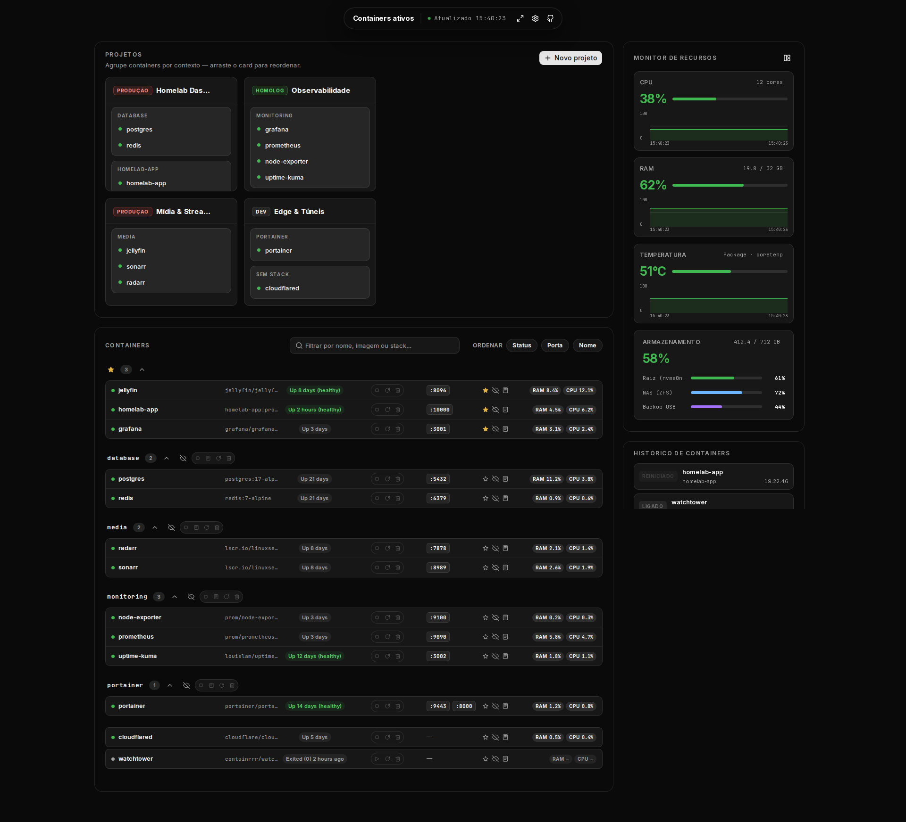

# Homelab Homepage

Dashboard de containers Docker do homelab: containers agrupados por stack, ações
(iniciar/parar/reiniciar/apagar), logs ao vivo, projetos, histórico de lifecycle e
monitor de CPU, RAM, temperatura e armazenamento do host.

A v3 é **um binário Go estático** (~13 MB) que serve a API, as atualizações em tempo
real (SSE) e o frontend embutido: TypeScript sem framework, aplicado no DOM com
[idiomorph](https://github.com/bigskysoftware/idiomorph). Mesma UI e mesmas APIs da
v2 (Next.js), com o mesmo SQLite.



## v2 → v3 (medido em produção, 56 containers)

| | v2 (Next.js) | v3 (Go) |
|---|---|---|
| RAM do container | ~125 MiB | ~8 MiB |
| Imagem | 587 MB | 13,6 MB |
| JS na 1ª carga (gzip) | ~280 KB | 20,7 KB |
| HTML da home | 322 KB | 20 KB (5,7 KB gzip) |
| CPU do `dockerd` com o painel aberto | 10,1% de um núcleo | 2,2% |
| CPU do `dockerd` sem ninguém olhando | 10,1% | 0,6% (coletor pausa) |
| Atualização da UI | polling de 16 KB a cada 5s | SSE só quando muda; `docker stop` aparece em ~0,3s |

O ganho no `dockerd` vem principalmente de deixar de chamar `/system/df` a cada 60s
(~4 s de CPU por chamada; agora só ao abrir o detalhe de armazenamento) e de ler
CPU/memória dos containers direto do cgroup v2.

## Como funciona

- **Métricas:** CPU/memória por container lidas de `/sys/fs/cgroup/.../docker-<id>.scope`
  (mesma fórmula do `docker stats`); host via `/proc`, `hwmon` e `statfs`.
- **Docker:** uma listagem `/containers/json` por ciclo de 5s e o stream `/events`
  para reagir na hora a start/stop/die.
- **Tempo real:** `/api/stream` (SSE) envia o snapshot só quando algo muda; o coletor
  pausa após 30s sem clientes.
- **Frontend:** `web/src/render.ts` gera HTML em string; `Idiomorph.morph` aplica só as
  diferenças, preservando foco, menus e scroll.

## Produção

```sh
make deploy   # BUILD_ID=<sha> docker compose -f infra/compose.production.yaml up -d --build
```

Porta **80**. O diretório `data/` (SQLite) precisa pertencer ao uid da imagem:
`sudo chown -R 65532:65532 data`. Ajuste `group_add` no compose conforme o GID do grupo
`docker` (`getent group docker`).

| Variável | Padrão | Descrição |
|---|---|---|
| `LINK_HOST` | *(host da requisição)* | Hostname nos links das portas (`http://HOST:porta`) |
| `DOCKER_SOCKET` | `/var/run/docker.sock` | Socket da API Docker |
| `HOST_ROOT` | `/host` | Raiz do host montada (cgroup, sensores, discos) |
| `DB_PATH` | `/data/homepage.db` | SQLite de preferências e projetos |
| `HOMELAB_MOCK` | — | `1` = dados fictícios, sem Docker nem SQLite |

## Desenvolvimento

Requisitos: Node 22+ e Docker (o Go roda em container; não precisa estar instalado).

```sh
npm install
make check    # assets, typecheck, gofmt, go vet e testes (-race)
make mock     # preview com dados fictícios em http://localhost:10003
npm run screenshot:mock   # atualiza docs/screenshots (usa o preview da 10003)
```

Ciclo rápido no frontend (assets servidos do disco, recompilados a cada alteração):

```sh
npm run watch:web &
docker run --rm -it -p 3000:3000 -v "$PWD":/src -w /src \
  -e HOMELAB_DEV=1 -e HOMELAB_MOCK=1 golang:1.25 go run ./cmd/homelab
```

## Estrutura

- `mac/` — app macOS de menu bar ([Homelab Bar](mac/README.md)), cliente da API v3
- `cmd/homelab` — entrada (servidor e `homelab healthcheck`)
- `internal/` — `docker`, `metrics`, `hub` (SSE), `store` (SQLite), `history`, `server`, `mock`
- `web/` — frontend (`src/`), estilos, fontes e `index.html` (embutidos no binário)
- `infra/` — `Dockerfile` (alvos padrão e `mock`) e `compose.production.yaml`
- `PLAN-V3.md` — plano, specs e critérios de aceite da v3

## Licença

MIT
